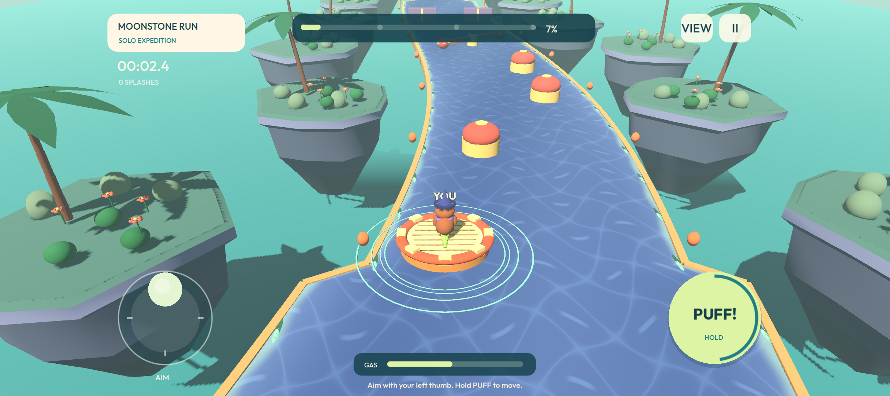

# Puff Crew: Rapids

An original 3D Android raft game inspired by the cooperative movement concept studied in Fart Together. One capybara can sail solo, or 2–4 players can steer one raft from phones on the same Wi-Fi. Version 0.2.0 is a playable development build with three short courses.



## Play on Android

1. Transfer **Puff-Crew-0.2.0-Playtest.apk** to the phone and open it. Android may ask you to allow installation from the app opening the file.
2. Launch **Puff Crew: Rapids** and choose a river.
3. Tap **Set sail solo**, or use **Bring your crew** for Wi-Fi co-op.

The APK supports **64-bit ARM Android devices, Android 7.0/API 24 or later, with OpenGL ES 3.0**. It is a signed debug build for direct installation and playtesting. Google Play publishing would require a release identity and a signed Android App Bundle.

## What changed in 0.2.0

- Flowing water with caustic light patterns, shoreline foam and deeper channel color.
- Cleaner raft shading, scenery batching in cullable chunks and a visibly swirling whirlpool.
- Blinking characters, animated arms/scarves and three original hats with matching scarves.
- **Crew outfits** previews/equips Classic, Mariner, Sun Seeker and Stargazer; outfits sync over LAN.
- Performance/Balanced/High graphics and sound/haptics controls, accessible from pause.
- Finish-screen confetti; Ramo Labs branding, in-game privacy and readable bundled licenses.

All outfits are available in this playtest. Checkout and the native billing SDK are excluded. Publishing is paused at the owner's request; older local release-preparation artifacts are not the current game and should not be uploaded.

## Controls

- Drag the left thumb stick to aim your capybara in the direction you want to move.
- Hold **PUFF!** with your right thumb to apply thrust. Release it to refill gas.
- Momentum continues when thrust stops. Aim backwards and puff to brake.
- In co-op, every player's thrust contributes to the same raft. The **YOU** marker identifies your character.
- **VIEW** switches between the following and higher camera. **II** or Android Back opens pause.
- Gold arrows boost the raft for the short jump. Avoid the whirlpool eye, time the gates and steer around sweepers and bumpers.
- Falling restores the last checkpoint. Completed runs receive a results screen and save a best time locally.

The three courses share a 210 m route structure with different bends, widths, hazard placement/speed, water colors and island palettes. They are compact obstacle runs, with room for more content in later versions.

## Wi-Fi co-op

1. Connect all phones to the same Wi-Fi network.
2. The captain selects **Bring your crew → Host a crew**. Keep the captain's app in the foreground.
3. Friends select **Bring your crew** and tap the discovered crew. If discovery is unavailable, enter the captain's displayed IPv4 address and select **Join by IP**.
4. Each friend taps **Ready**. The captain taps **Launch crew** once 2–4 players are ready.

The app uses UDP **28970** for gameplay and **28971** for discovery. Guest networks with client isolation can prevent phones from communicating; use a network that permits communication between devices. Manual IP joining remains available when broadcasts are filtered. A Wi-Fi hotspot may work where it allows connected devices to communicate; that configuration has not been tested.

The captain runs the simulation. A departing crewmate can leave the remaining crew sailing. If the captain leaves, the session ends and friends return to shore. The first build allows joining before launch and has no host migration or mid-run rejoining. A pause by the captain pauses the crew; a client's pause releases that client's controls while the captain keeps simulating.

## Visuals and audio

The game uses original procedural 3D capybaras, raft, palms, gardens, layered floating islands, animated water, wake rings and gas effects. Sunlit Shoals, Mango Twist and Moonstone Run use distinct water/island palettes. Static scenery is batched by material, and the renderer uses mobile-compatible OpenGL ES 3.

Sound effects and the quiet river music were generated for this project. Their editable generator is `tools/generate_audio.py` in the source distribution. Outfit is included under the SIL Open Font License; see `assets/FONT-LICENSE.txt`.

The included screenshots and video come from the game renderer. The video is an automated gameplay demonstration. Visual parity with the reference and performance across physical Android phones require further user/device evaluation.

## Open and build the source

Open `project.godot` in **Godot 4.7.2**, then run the project. Desktop controls are **WASD/arrows**, **Space** to puff, and **Escape** to pause. Mouse dragging can operate the joystick and menu; a keyboard is useful for simultaneous desktop aiming and thrust.

For Android, install the matching Godot export templates, OpenJDK 17 and the Android SDK. Configure Java and SDK paths in Godot's Android export settings. The supplied preset uses the matching Gradle template for an ARM64 playtest APK; the build helper installs that template if missing.

From the source distribution's top-level directory:

```sh
./tools/build_android.sh
```

Or from the Godot project directory:

```sh
godot --headless --editor --import --quit
godot --headless --export-debug Android ../builds/Puff-Crew-0.2.0-Playtest.apk
```

A standard development keystore is used by the local Godot installation. No private signing key or machine-specific credentials are included in the source archive.

## Architecture

- `scripts/game.gd`: fixed-step arcade movement, stamina, jumps/falls, checkpoints, scores, lifecycle and host-authoritative ENet sessions.
- `scripts/course.gd`: course definitions, procedural scenery and moving hazards.
- `scripts/raft.gd` and `scripts/visuals.gd`: original 3D geometry and animation.
- `scripts/hud.gd`: responsive landscape UI, multi-touch ownership, menu/lobby and pause/result flows.
- `scripts/audio.gd`: effects, music, mute control and resource shutdown.
- `shaders/water.gdshader`: animated procedural water.
- `tests/`: behavioral checks, full-course driver and automated video capture.

The host simulates at 60 Hz, sends snapshots at 20 Hz during play, and accepts bounded per-player inputs at approximately 30 Hz. Clients interpolate raft presentation. Physics combines planar forces and torque with separate jump/fall height and visual tilt. There is no cloud backend, account requirement, advertising or analytics; network traffic serves local discovery and player connections.

## Validation

See `docs/QA.md`. The first build has passed behavioral tests, complete automated runs of all courses, a four-process desktop co-op test, Android solo touch/UI tests, an Android-client/desktop-host test and an Android-host/Android-client test over shared emulated Wi-Fi, including discovery. Physical phones and real routers remain untested.
